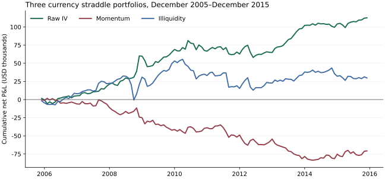

# Which characteristics help select FX straddles?

Does ranking currencies by past straddle returns or by the width of the option bid–ask spread improve on a simple implied-volatility (IV) trade? We test each characteristic on its own, each of the three pairs of characteristics, and all three together in a monthly portfolio of one-month FX straddles.

**Raw IV alone earned the highest net P&L and Sharpe in the development comparison.** Buying low-IV straddles and selling high-IV straddles earned $110,183 over the 109 months shared by all specifications. Adding a bid–ask spread screen earned $77,959. The same standalone IV rule earned just $1,013 over the subsequent ten years.

## Research papers and benchmarks

**The baseline strategy** comes from Fullwood, James and Marsh (2021), *Volatility and the Cross-Section of Returns on FX Options*. They buy low-IV and sell high-IV straddles. Their monthly comparison reports a mean long–short return of 42.53% on entry premium (Table 12). We apply their ranking rule to six USD pairs and measure the net dollar P&L of a vega-sized portfolio. [Paper and accepted manuscript](https://openaccess.city.ac.uk/id/eprint/24959/)

**The main paper for the three characteristics** is Zhang, So and Driouchi (2024), *Common Risk Factors in Cross-Sectional FX Options Returns*. They rank nine USD currencies each Wednesday over 2001–2022 and hold the straddles for one month. Of 38 characteristics tested individually, 22 produced significant long–short spreads. The three below explain much of that evidence. Each column gives a mean one-month spread in the indicated trading direction. [Paper, Tables 3–5 and online appendix Table A11](https://doi.org/10.1093/rof/rfae002)

| Characteristic | Long leg / short leg | On entry premium, one currency per side | On notional, one per side | On entry premium, two per side (A11) |
| --- | --- | ---: | ---: | ---: |
| IV | Low IV / high IV | +33.9 pp | +38.2 bp | +30.0 pp |
| Long-term straddle momentum (MOM) | Past winners / past losers | +60.1 pp | +63.0 bp | +39.9 pp |
| Illiquidity | Narrow IV spread / wide IV spread | +18.0 pp | +18.5 bp | +10.3 pp |

The authors tabulate low minus high for every signal. We reverse the sign of their MOM row to display winners minus losers. In Table A11, “two per side” widens the holdings selected by **one** ranking. In Table 7, the authors use the three separately constructed factor return series together in a regression. The other 19 significant strategies have statistically insignificant alphas after that adjustment. Our combination tests ask whether requiring each currency to pass multiple screens improves the trades. [Accepted manuscript, sections 3.1–3.3](https://kclpure.kcl.ac.uk/portal/en/publications/common-risk-factors-in-cross-sectional-fx-options-returns/)

## Single, double and triple sorts on the same 109 months

Every row below uses raw signal levels and the same expiry window, December 2006–December 2015. This is the window shared by every raw and trailing-z specification. Net P&L is cumulative USD after modeled option execution and premium financing. Sharpe uses all 109 months, including months spent in cash.

| Characteristics used to select holdings | Active months | Net P&L (USD) | Annualized Sharpe | Raw IV at the same monthly gross vega (USD) |
| --- | ---: | ---: | ---: | ---: |
| IV alone | 109 | +110,183 | 0.886 | +110,183 |
| MOM alone | 109 | −67,296 | −0.626 | +110,183 |
| Illiquidity alone | 109 | +25,385 | 0.164 | +110,183 |
| IV + MOM | 100 | +30,830 | 0.309 | +65,653 |
| IV + illiquidity | 109 | +77,959 | 0.628 | +111,556 |
| MOM + illiquidity | 105 | −5,125 | −0.047 | +89,873 |
| IV + MOM + illiquidity | 78 | +27,955 | 0.311 | +42,993 |

IV + illiquidity led the combinations. When raw IV used that pair’s actual vega month by month, it earned $111,556, a $33,597 advantage. The estimated monthly difference for the pair versus matched IV was −$308, with a 95% HAC interval from −$759 to +$143. All 20 combinations trailed matched raw IV on both cumulative P&L and Sharpe in this sample. The raw MOM + illiquidity result was close enough to zero that reversing the ticker tie-break changed its sign.

Each signal can also be ranked by its **trailing z-score**. We compare the current reading with the same currency’s preceding 12 monthly readings, then rank the six currencies. This can change which currencies qualify. Standardizing across the six currencies on the same date preserves their ordering. The full results cover six single-signal specifications, twelve two-signal specifications and eight three-signal specifications. [All 26 results, including active months and matched-IV Sharpe](results/characteristic-sorts.md)

### How a double sort changes the trade

- **Single sort.** Rank all six currencies on one characteristic. Buy the best two and sell the worst two. Low IV, high MOM and a narrow IV spread are favorable in their respective rankings.
- **Independent double sort, used here.** Rank all six separately on each of two characteristics. Buy the intersection of their favorable halves (top three in both rankings). Sell the intersection of their unfavorable halves (bottom three in both). Swapping the order of the signals gives the same holdings. Splitting capital between two standalone portfolios would keep trades that qualify on only one signal. A *sequential* double sort would form groups on the first signal and re-rank currencies **within** each group on the second. We report results for the independent rule.
- **Triple sort.** Apply the same intersection to all three rankings. If either side is empty, both sides stay in cash. When both sides qualify, each side has equal total vega, capped at $500 per volatility point, with at most $250 per currency. This explains why portfolios can trade in the same month at different sizes.

For the **December 2006 expiry**, the three lowest-IV currencies at entry were HKD, CAD and MXN. The three narrowest IV spreads belonged to JPY, CAD and CHF. **CAD** qualified for both long screens, and **SEK** was the only currency in both short screens. The double sort bought CAD and sold SEK at $250 vega each. Adding MOM kept CAD eligible but removed SEK from the short side. The triple sort held cash that month.

## Single characteristics over the longer 121-month window

All three signals were available from December 2005 through December 2015, measured by expiry. P&L is in USD after modeled option bid–ask execution and premium financing. Each portfolio uses the same USD vega budget.

| Monthly sort | Buy | Sell | Cumulative net P&L | Annualized Sharpe |
| --- | --- | --- | ---: | ---: |
| Implied volatility | Lowest IV | Highest IV | +112,602 | 0.84 |
| Straddle momentum | Past winners | Past losers | −70,744 | −0.62 |
| Illiquidity | Narrowest IV spreads | Widest IV spreads | +29,760 | 0.18 |

### Why the return denominator matters

On the same momentum holdings, the winners’ subsequent return per dollar of entry premium exceeded the losers’ by **12.8 percentage points** on average. On equal forward notional, winners paid **68.2 basis points** more at expiry but cost **82.5 basis points** more upfront. The spread on notional was **−14.3 basis points**. Both comparisons use unhedged straddles at entry mid premiums. The dollar P&L in the table uses executable quote sides, a hedge and equal vega per position.

Zhang, So and Driouchi report a **+39.9 percentage point** momentum spread on premium with two currencies per side (online appendix, Table A11). They rank nine currencies weekly. The different currency sets, formation frequencies and lookbacks leave the source of the gap open. [Paper and online appendix](https://doi.org/10.1093/rof/rfae002) · [Authors’ factor data](https://raymondhyso.com/research)

### Which currencies contributed to raw IV profits?

Over all 131 development months (February 2005–December 2015), MXN earned **$79,404**, or **76.3%** of the portfolio’s $104,054 net profit. JPY contributed another 20.9% and CAD 15.0%, while HKD reduced total profit by $11,559. Leadership varied by year. JPY contributed the most in 2007 and 2013, and CAD led in 2015. [Long and short positions, annual net P&L and annual contribution shares for all six currencies](results/in-sample-currency-attribution.md)

### How well did raw IV carry forward?

On its full development period (February 2005–December 2015, 131 months), raw IV earned **USD 104,054** with a **0.72 Sharpe**. Applying the same rule over January 2016–December 2025 (120 months) earned **USD 1,013** with a **0.01 Sharpe**. This later period had already been inspected for the baseline. The momentum and illiquidity comparisons use development data only.

## Portfolio construction

- The six pairs are USD/CAD, USD/CHF, USD/HKD, USD/JPY, USD/MXN and USD/SEK. Each European straddle combines a call and put struck at the one-month forward and held to a next-month-end expiry proxy.
- Raw IV uses the one-month ATM midpoint. Illiquidity uses ask IV less bid IV. Momentum sums the nine most recent unhedged straddle returns whose expiries strictly precede entry. The underlying raw-IV sort follows [Fullwood, James and Marsh (2021)](https://doi.org/10.1016/j.jfineco.2021.04.030).
- Each single-signal portfolio holds four positions at USD 250 vega per volatility point. The double and triple sorts scale exposure to the number of eligible names as described above. Longs pay ask and shorts receive bid. An initial forward delta hedge is held through expiry. Returns use USD 1 million of fixed reference capital. The model omits forward execution spreads and margin costs.

## Reproduce the reported results

Run `python analyze.py` with Python 3.9 or later for the longer single-signal comparison, raw-IV follow-up and momentum spreads. Run `python analyze.py --sorts` to also calculate all 26 common-window portfolios and their exposure-matched IV benchmarks. For the chart, install Matplotlib and run `python analyze.py --plot`. [Single-signal monthly P&L](data/monthly_pnl.csv) · [Monthly net P&L and gross vega for all 26 sorts](data/monthly_sorts.csv)

The single-signal file rounds P&L to cents and momentum spreads to four decimals. Empty observations mark unavailable or unevaluated results. The 26-sort file retains the calculated portfolio P&L and exposure for each month. Repricing the underlying trades requires separate access to the historical IV bid/ask, spot, one-month forward and USD funding inputs.
