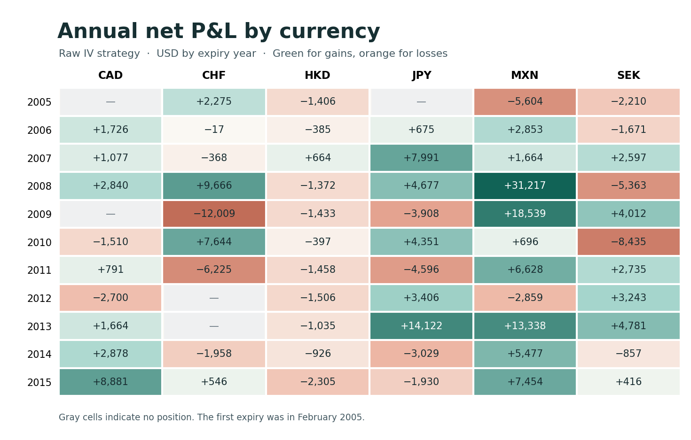

# Currency contributions to the raw IV strategy, 2005–2015

At each month-end, the strategy buys the two lowest-IV straddles and sells the two highest-IV straddles among six USD currency pairs. The tables group trades by expiry year. The first expiry was in February 2005 and the last was in December 2015, giving 131 months and 524 positions. Net P&L includes option bid–ask execution, the initial forward hedge and USD premium financing. Dollar amounts are rounded independently after aggregation.

## Long and short positions by currency

Each position count is the number of months the strategy held that currency on that side. The portfolio row counts two long and two short positions per month across 131 months. The final column divides each currency’s cumulative net P&L by the portfolio’s cumulative net P&L.

| Currency | Long months | Long net P&L (USD) | Short months | Short net P&L (USD) | Total net P&L (USD) | Share of portfolio P&L |
| --- | ---: | ---: | ---: | ---: | ---: | ---: |
| MXN | 28 | +14,660 | 63 | +64,744 | +79,404 | 76.3% |
| JPY | 18 | −5,337 | 36 | +27,095 | +21,758 | 20.9% |
| CAD | 57 | +13,201 | 9 | +2,447 | +15,648 | 15.0% |
| CHF | 28 | +3,475 | 40 | −3,920 | −446 | −0.4% |
| SEK | 0 | 0 | 114 | −752 | −752 | −0.7% |
| HKD | 131 | −11,559 | 0 | 0 | −11,559 | −11.1% |
| **Portfolio** | 262 | +14,440 | 262 | +89,614 | **+104,054** | **100.0%** |

MXN contributed 76.3% of portfolio net P&L, with $64,744 from selling straddles. JPY also earned most of its profit on the short side. CAD earned $13,201 on the long side. HKD occupied a long slot in all 131 months and lost $11,559 in total.

## Annual net P&L by currency

All amounts are USD. A dash indicates that the strategy held no position in that currency during the year.

| Expiry year | Portfolio | CAD | CHF | HKD | JPY | MXN | SEK |
| --- | ---: | ---: | ---: | ---: | ---: | ---: | ---: |
| 2005 | −6,945 | — | +2,275 | −1,406 | — | −5,604 | −2,210 |
| 2006 | +3,181 | +1,726 | −17 | −385 | +675 | +2,853 | −1,671 |
| 2007 | +13,625 | +1,077 | −368 | +664 | +7,991 | +1,664 | +2,597 |
| 2008 | +41,666 | +2,840 | +9,666 | −1,372 | +4,677 | +31,217 | −5,363 |
| 2009 | +5,202 | — | −12,009 | −1,433 | −3,908 | +18,539 | +4,012 |
| 2010 | +2,349 | −1,510 | +7,644 | −397 | +4,351 | +696 | −8,435 |
| 2011 | −2,125 | +791 | −6,225 | −1,458 | −4,596 | +6,628 | +2,735 |
| 2012 | −417 | −2,700 | — | −1,506 | +3,406 | −2,859 | +3,243 |
| 2013 | +32,870 | +1,664 | — | −1,035 | +14,122 | +13,338 | +4,781 |
| 2014 | +1,585 | +2,878 | −1,958 | −926 | −3,029 | +5,477 | −857 |
| 2015 | +13,063 | +8,881 | +546 | −2,305 | −1,930 | +7,454 | +416 |
| **Full period** | **+104,054** | +15,648 | −446 | −11,559 | +21,758 | +79,404 | −752 |

## Annual share of portfolio net P&L

Each percentage divides the currency’s net P&L by the six-currency portfolio’s net P&L for that expiry year. In a portfolio loss year, a profitable currency has a negative share. Shares can exceed 100% when gains and losses offset. For example, in 2009 MXN earned $18,539 and the other five currencies together lost $13,337, leaving $5,202 for the portfolio.

| Expiry year | Portfolio net P&L (USD) | CAD | CHF | HKD | JPY | MXN | SEK |
| --- | ---: | ---: | ---: | ---: | ---: | ---: | ---: |
| 2005 | −6,945 | — | −32.8% | 20.2% | — | 80.7% | 31.8% |
| 2006 | +3,181 | 54.3% | −0.5% | −12.1% | 21.2% | 89.7% | −52.5% |
| 2007 | +13,625 | 7.9% | −2.7% | 4.9% | 58.6% | 12.2% | 19.1% |
| 2008 | +41,666 | 6.8% | 23.2% | −3.3% | 11.2% | 74.9% | −12.9% |
| 2009 | +5,202 | — | −230.8% | −27.6% | −75.1% | 356.4% | 77.1% |
| 2010 | +2,349 | −64.3% | 325.4% | −16.9% | 185.2% | 29.6% | −359.1% |
| 2011 | −2,125 | −37.2% | 292.9% | 68.6% | 216.3% | −311.9% | −128.7% |
| 2012 | −417 | 648.2% | — | 361.6% | −817.6% | 686.2% | −778.4% |
| 2013 | +32,870 | 5.1% | — | −3.1% | 43.0% | 40.6% | 14.5% |
| 2014 | +1,585 | 181.6% | −123.5% | −58.4% | −191.1% | 345.6% | −54.1% |
| 2015 | +13,063 | 68.0% | 4.2% | −17.6% | −14.8% | 57.1% | 3.2% |
| **Full period** | **+104,054** | 15.0% | −0.4% | −11.1% | 20.9% | 76.3% | −0.7% |
