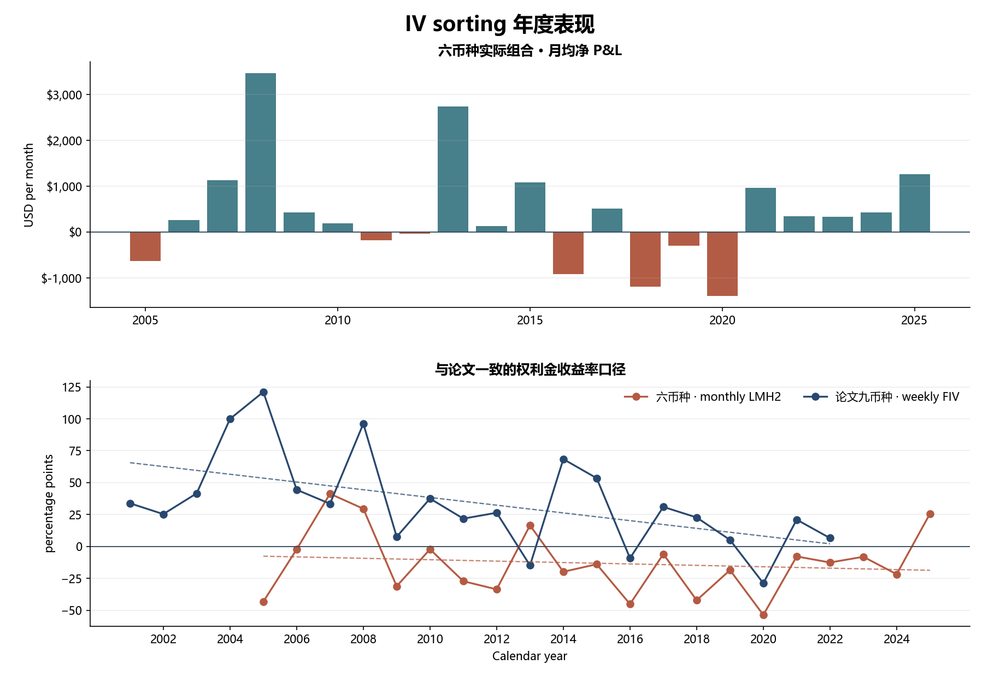
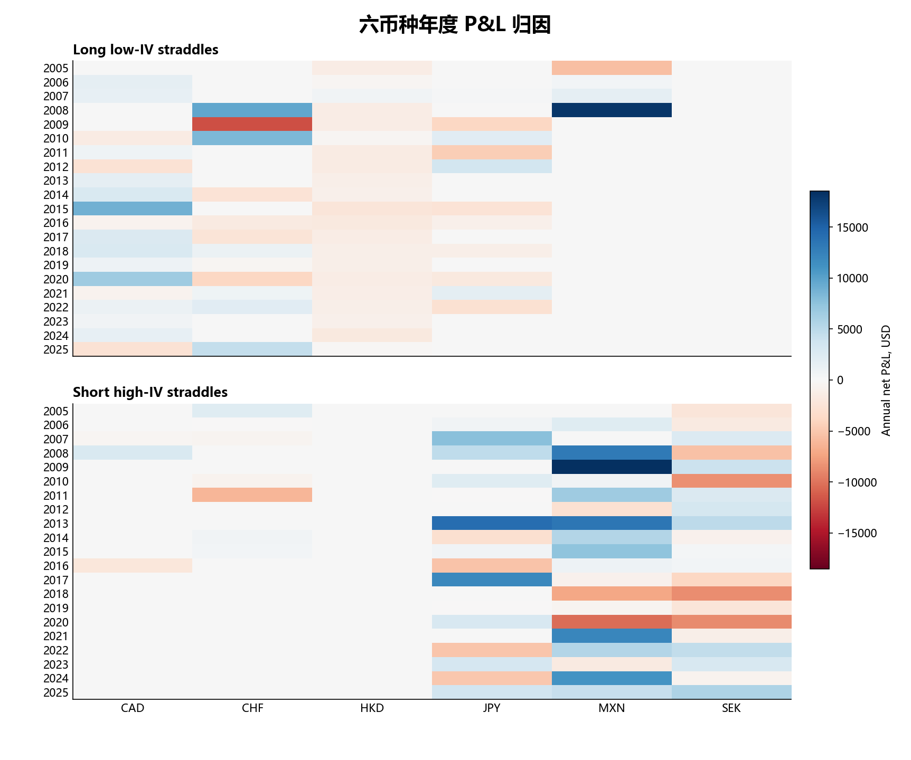

# IV factor decay and currency-side attribution

This note asks whether the raw implied-volatility strategy became less profitable and whether the deterioration can be localized to particular currencies or portfolio sides. It is a retrospective diagnosis of a fixed strategy. It does not search for a new signal, currency subset, cutoff date or trading rule.

## Data and return definitions

The six-currency strategy ranks USD/CAD, USD/CHF, USD/HKD, USD/JPY, USD/MXN and USD/SEK each month. It buys the two lowest-IV straddles and sells the two highest-IV straddles. The sample contains 251 expiry months from February 2005 through December 2025 and 1,004 selected positions.

Two six-currency performance measures answer different questions:

- **Implementable net USD P&L** is the project portfolio's vega-sized result. It includes option bid–ask execution, the initial forward hedge and USD premium financing.
- **Premium return** follows the paper-style payoff-to-entry-premium definition. Each month it averages the two long returns and the two short returns and adds the two sides. It excludes the project hedge and financing so that its economic unit resembles the published factor data.

The external comparison is Zhang, So and Driouchi's public weekly **FIV** series for nine USD currencies from 9 March 2001 through 23 December 2022. Its values are percentage-point returns on entry premium. Weekly one-month holdings overlap, so weekly tests use four-lag Bartlett HAC standard errors.

The levels of the six- and nine-currency premium-return series are not directly interchangeable. The universes, frequency, holding overlap, portfolio weights, execution convention and selected number of currencies differ. The common-period trends are a direction-of-change comparison, not a claim that the two portfolios are identical.

## What each statistic tests

- **Segment mean t-statistic:** null hypothesis that a period's mean equals zero. This describes whether that segment earned a detectable average; it does not test decay.
- **Linear trend:** regression of the bottom-frequency return on calendar time, with the null that the annual slope equals zero.
- **Fixed split:** regression on a post-period indicator, with the null that the later mean minus the earlier mean equals zero. The six-pair split is January 2016, the end of the development window. The nine-pair split follows the end of the original Fullwood sample, 28 September 2016.
- **Common interval:** separate time trends over 2006–2022, when both premium-return series are available.

Trend and split regressions use HAC(4) standard errors. In the annual display, six-currency monthly observations are non-overlapping and use conventional within-year t-statistics; the weekly FIV series uses HAC(4). Annual currency-side cells use ordinary within-cell t-statistics. Their p-values are adjusted together with the Benjamini–Hochberg procedure because the table contains many tests.

## Factor-level results

| Universe and test | Earlier mean | Later mean | Estimate | HAC t | Two-sided p | 95% interval |
| --- | ---: | ---: | ---: | ---: | ---: | ---: |
| Six currencies, USD P&L trend, 2005–2025 | — | — | −$30.02 per year | −0.856 | 0.392 | [−$98.73, +$38.69] |
| Six currencies, post-2015 minus development USD P&L | $794.30/month | $8.44/month | −$785.87/month | −1.889 | 0.059 | [−$1,601.43, +$29.70] |
| Six currencies, premium-return trend, 2005–2025 | — | — | −0.552 pp/year | −0.621 | 0.535 | [−2.293, +1.190] |
| Six currencies, post-2015 minus development premium return | −7.53 pp | −18.97 pp | −11.44 pp | −1.235 | 0.217 | [−29.61, +6.72] |
| Public nine-currency FIV trend, 2001–2022 | — | — | −3.027 pp/year | −4.351 | 0.000014 | [−4.391, −1.664] |
| Public nine-currency FIV, post-original minus original | 44.25 pp | 8.11 pp | −36.14 pp | −3.842 | 0.000122 | [−54.57, −17.70] |
| Six-currency premium-return trend, common 2006–2022 | — | — | −2.550 pp/year | −2.578 | 0.0099 | [−4.488, −0.611] |
| Nine-currency FIV trend, common 2006–2022 | — | — | −2.913 pp/year | −2.764 | 0.0057 | [−4.979, −0.847] |

The public nine-currency factor shows clear decay by both tests. Its post-original-sample mean is still positive, but it is not distinguishable from zero using HAC(4): 8.11 pp, t = 1.10, p = 0.271.

The six-currency USD implementation shows a large economic drop and borderline statistical evidence in the fixed split, but no significant smooth trend over the full 2005–2025 sample. The later mean-versus-zero t-statistic is 0.031 (p = 0.975). That statistic says the later mean is indistinguishable from zero; the post-minus-development coefficient is the relevant test of deterioration.

The common-period result is useful but narrower: from 2006 through 2022, both premium-return series have statistically negative time trends. It supports a shared decline in premium-normalized IV-sort performance, while the full six-pair sample also shows rebounds in 2023–2025.

## Where the six-currency P&L changed

Development covers 131 months from February 2005 through December 2015. The inspected follow-up covers 120 months from January 2016 through December 2025.

| Portfolio component | Development total | Development per month | Follow-up total | Follow-up per month |
| --- | ---: | ---: | ---: | ---: |
| Long low-IV side | +$14,440 | +$110.23 | −$4,839 | −$40.32 |
| Short high-IV side | +$89,614 | +$684.08 | +$5,852 | +$48.76 |
| **Full portfolio** | **+$104,054** | **+$794.30** | **+$1,013** | **+$8.44** |

Most of the lost P&L came from the short-high-IV side. The long side also crossed from a small profit to a loss.

| Currency and side | Selection rate, development → follow-up | Entry premium per trade | Expiry payoff per trade | Net P&L per trade | Total P&L, development → follow-up |
| --- | ---: | ---: | ---: | ---: | ---: |
| MXN short | 48.1% → 85.0% | $3,532 → $3,131 | $2,515 → $3,013 | +$1,028 → +$130 | +$64,744 → +$13,270 |
| JPY short | 27.5% → 37.5% | $2,838 → $2,702 | $2,093 → $2,569 | +$753 → +$136 | +$27,095 → +$6,099 |
| HKD long | 100.0% → 100.0% | $192 → $272 | $104 → $172 | −$88 → −$101 | −$11,559 → −$12,116 |
| CAD long | 43.5% → 51.7% | $1,892 → $1,578 | $2,122 → $1,777 | +$232 → +$196 | +$13,201 → +$12,153 |
| SEK short | 87.0% → 75.8% | $2,989 → $2,349 | $2,999 → $2,476 | −$7 → −$125 | −$752 → −$11,417 |

For MXN short, both sides of the option economics moved adversely: average premium received fell by about $401 while average payoff paid rose by about $498. The strategy selected MXN short more often, but its conditional profit per selected trade fell by about 87%. JPY short shows a similar, smaller compression. CAD long remained profitable. HKD long occupied one of the two low-IV slots every month and remained a persistent drag.

Of 120 currency-year-side cells with at least two selected trades, 25 had unadjusted p-values below 0.05. Seven remained below a 5% Benjamini–Hochberg false-discovery rate, and all seven were negative HKD-long cells. Positive MXN and JPY years are economically important to attribution, but individual annual-cell evidence is much less robust after correcting for the number of tests.

## Interpretation and limits

The evidence is consistent with a broad decline in premium-normalized IV-sort returns, because both universes trend downward over their common interval and the public nine-currency factor declines strongly after its original sample. It does not prove that one macro mechanism caused the decline.

Currency composition still matters. The six-pair universe structurally assigns HKD to the long-low-IV side and relies heavily on MXN and JPY short profits. The deterioration is therefore a combination of weaker conditional trade economics and the particular currencies that occupy each rank—not simply “MXN stopped working” or a one-time break in 2016.

This analysis is exploratory. The post-2015 six-currency period had already been inspected before these tests, so it is not a fresh out-of-sample validation. The annual currency heatmap and premium/payoff decomposition are useful for diagnosis, but they should not be used to choose a new currency subset and then claim unbiased performance on the same data. Additional Bloomberg pairs would help separate a general FX-options effect from a narrow-universe composition effect, but any new rule should be specified before examining a new holdout.

## Derived outputs

- [Annual strategy statistics](../data/iv_factor_decay/annual_strategy_statistics.csv)
- [Bottom-frequency trend and fixed-split tests](../data/iv_factor_decay/decay_and_trend_tests.csv)
- [Segment mean-versus-zero tests](../data/iv_factor_decay/segment_mean_statistics.csv)
- [Currency-period-side comparison](../data/iv_factor_decay/currency_period_side_comparison.csv)
- [Currency-year-side attribution and adjusted p-values](../data/iv_factor_decay/currency_year_side_attribution.csv)

These files contain derived aggregate results only. Historical Bloomberg option, spot, forward and funding observations are intentionally excluded.
